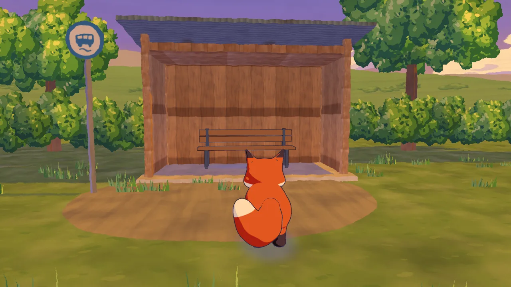
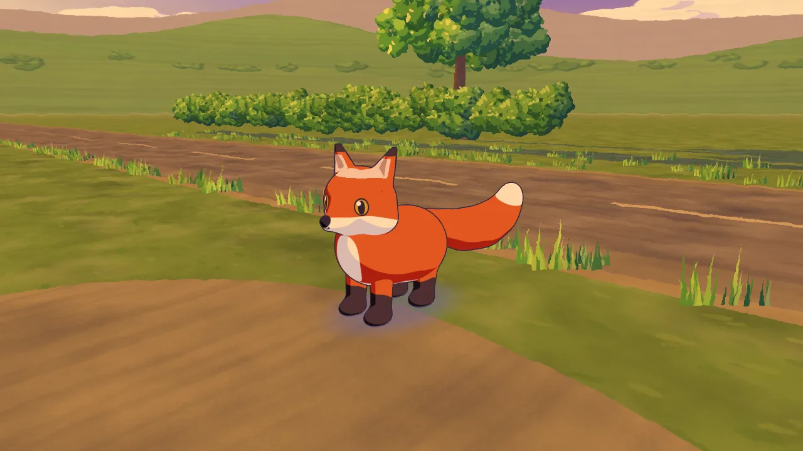

# Starter scene: fox at a rural bus stop (dusk)

A small, self-contained three.js scene built **from this skill alone** by a fresh agent (2026-11-26), as the
skill's test. It is a clean, non-Cat-RPG starting point for any new scene in the look: an original fox
mascot (inked, primitives merged with smooth normals), an inked bench, painted shelter, road, hedge, trees,
hill backdrops, painted sky, Day/Dusk phase keys, sun shadow with leaf-light, paint post, dither fade.

 

| File | What |
|---|---|
| `index.html` | import map → three@0.160.1 on jsDelivr |
| `main.js` | scene, camera, frame order (shadow → env RT → paint post → cels), `window.__ready` |
| `env.js`, `phases.js`, `post.js` | adapted from `../reference-impl/` (sky seam fixed: whole-number brush repeats) |
| `paint.js` | procedural painted textures (canvas), incl. the grain/brush utility textures |
| `fox.js`, `sdf.js` | the fox: primitives → mesh, two-tone fill, hull, per-eye decals |
| `shoot.js` | serves the folder, captures `outputs/shot-*.png` in headless Chromium (SwiftShader) |

Run (needs network for the CDN, and Playwright):

```bash
mkdir -p outputs && node shoot.js dusk        # or: day; add "orbit" as a 2nd arg for an 8-angle sweep
```

If `require('playwright')` fails, point `NODE_PATH` at the folder that has it installed. Copy the folder
somewhere else before running — it writes `outputs/` next to itself.

Known limits from its self-check: fox shade share swings 14–29% across angles at dusk; zone tint is a
simple CPU ray; Morning/Night keys not built.
